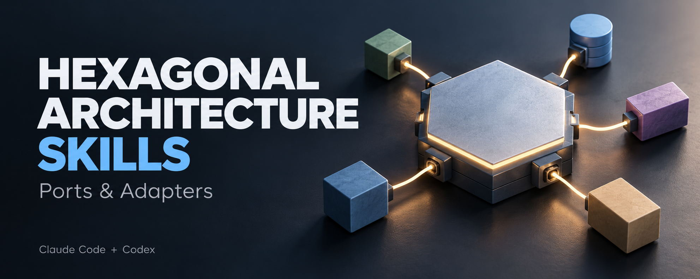
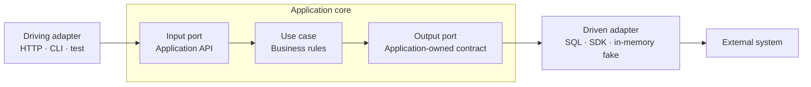

# Hexagonal Architecture Skills

**Claude Code와 OpenAI Codex에서 함께 쓰는 헥사고날 아키텍처(Ports and Adapters) 스킬.**

코드 리뷰, 기능 설계, 점진적 리팩토링을 통해 애플리케이션의 비즈니스 규칙과 외부 기술의 경계를 검토합니다. 두 도구가 **동일한 `SKILL.md`**를 사용하며, 각각의 플러그인 마켓플레이스와 심볼릭 링크 설치를 지원합니다.

이 저장소는 [nathankim0/clean-architecture-skills](https://github.com/nathankim0/clean-architecture-skills)의 리뷰 흐름과 Claude Code / Codex 공통 배포 구조를 참고해 만들었습니다. 아키텍처 원칙은 [Alistair Cockburn의 Hexagonal Architecture](https://alistair.cockburn.us/hexagonal-architecture)에 기반합니다.

## 무엇을 검토하나요?

| 항목 | 검토 내용 |
| --- | --- |
| 코어 독립성 | 비즈니스 규칙이 HTTP, ORM, DB, 외부 SDK 구현에 묶여 있는가? |
| 입력 포트 | 호출자가 사용할 애플리케이션 API가 명확한가? |
| 출력 포트 | 외부에 필요한 기능을 애플리케이션의 언어로 정의했는가? |
| 어댑터 경계 | 외부 입력·데이터·오류 변환과 비즈니스 판단이 적절히 나뉘어 있는가? |
| 의존성 방향 | 코어가 구체 어댑터를 import하지 않고 계약을 통해 사용하는가? |
| 조립과 동작 보존 | 의존성 주입, 트랜잭션, 검증, 오류 처리 등 기존 동작이 유지되는가? |
| 테스트 가능성 | 서버나 DB 없이 유스케이스를 테스트하고 어댑터 계약도 검증할 수 있는가? |

폴더 이름이나 계층 수만으로 아키텍처를 판정하지 않습니다. 실제 호출과 의존성을 확인하고, 문제를 해결하는 가장 작은 변경을 제안합니다. DDD, CQRS, 이벤트 버스, 클래스별 인터페이스를 일괄 도입하지 않습니다.

## 설치

플러그인 설치와 심볼릭 링크 설치 중 하나를 선택하세요. 둘을 함께 설치하면 같은 스킬이 중복 표시될 수 있습니다.

### Claude Code

Claude Code 안에서 실행합니다.

```text
/plugin marketplace add nathankim0/hexagonal-architecture-skills
/plugin install hexagonal-architecture@hexagonal-architecture-skills
```

설치 후 새 세션에서 호출합니다.

```text
/hexagonal-architecture:hexagonal-architecture 이 기능의 포트와 어댑터 경계를 리뷰해줘.
```

### OpenAI Codex

`codex plugin`을 지원하는 CLI에서는 터미널에서 실행합니다.

```bash
codex plugin marketplace add nathankim0/hexagonal-architecture-skills
codex plugin add hexagonal-architecture@hexagonal-architecture-skills
```

설치 후 새 Codex 세션에서 `/skills`로 선택하거나 명시적으로 호출합니다.

```text
$hexagonal-architecture:hexagonal-architecture 이 기능의 포트와 어댑터 경계를 리뷰해줘.
```

`codex plugin`이 없는 버전이나 IDE 환경에서는 아래 심볼릭 링크 설치를 사용하세요.

### 심볼릭 링크 설치 — 같은 원본을 계속 관리하기

macOS/Linux에서는 저장소를 복제한 뒤, 두 도구가 같은 스킬 폴더를 가리키게 연결할 수 있습니다.

```bash
git clone https://github.com/nathankim0/hexagonal-architecture-skills.git
cd hexagonal-architecture-skills
skill_source="$PWD/plugins/hexagonal-architecture/skills/hexagonal-architecture"
```

Claude Code 사용자 스킬로 설치:

```bash
mkdir -p ~/.claude/skills
test ! -e ~/.claude/skills/hexagonal-architecture && test ! -L ~/.claude/skills/hexagonal-architecture && ln -s "$skill_source" ~/.claude/skills/hexagonal-architecture
```

Codex 사용자 스킬로 설치:

```bash
mkdir -p ~/.agents/skills
test ! -e ~/.agents/skills/hexagonal-architecture && test ! -L ~/.agents/skills/hexagonal-architecture && ln -s "$skill_source" ~/.agents/skills/hexagonal-architecture
```

위 두 설치 명령은 `skill_source`를 설정한 같은 셸에서 실행하세요. `SKILL.md`, 참고 파일, UI 메타데이터까지 같은 원본을 사용합니다. 저장소에서 `git pull`하면 두 도구가 최신 원본을 읽습니다. 스킬이 표시되지 않거나 변경 내용이 반영되지 않으면 새 세션을 시작하세요. 마켓플레이스 설치는 도구가 관리하는 캐시를 사용하므로 해당 도구의 플러그인 업데이트가 필요합니다.

같은 이름의 스킬을 이미 설치했다면 먼저 해당 폴더를 확인하세요. 위 명령은 기존 폴더·링크가 있으면 중단하므로, 내용을 확인하고 경로를 비운 뒤 다시 실행해야 합니다. 원본 저장소를 이동하거나 삭제하면 링크가 끊어지므로 다시 연결해야 합니다. 프로젝트에서만 쓰려면 사용자 디렉터리 대신 프로젝트의 `.claude/skills/` 또는 `.agents/skills/`에 링크를 만드세요. 심볼릭 링크를 사용할 수 없는 환경에서는 같은 스킬 폴더를 복사해 설치할 수 있습니다.

수동 설치에서는 각각 다음 이름으로 호출합니다.

```text
Claude Code: /hexagonal-architecture
Codex:      $hexagonal-architecture
```

설치 경로와 플러그인 구성은 [Claude Code Skills](https://code.claude.com/docs/en/skills), [Claude Code Plugin Marketplaces](https://code.claude.com/docs/en/plugin-marketplaces), [OpenAI Build Skills](https://learn.chatgpt.com/docs/build-skills), [OpenAI Plugin Packaging](https://developers.openai.com/plugins/build/plugins)을 따릅니다.

## 사용 예시

명시적 호출 외에도 관련 요청에서 자동 선택될 수 있습니다. 스킬 지침은 영어로 작성했으며, 결과는 사용자의 언어로 답하도록 구성했습니다.

**코드 리뷰**

```text
주문 생성 흐름을 헥사고날 아키텍처 관점에서 리뷰해줘.
실제 파일과 호출 경로를 근거로 위반 사항과 가장 작은 개선안을 알려줘.
```

**새 기능 설계**

```text
현재 프로젝트 구조에 맞춰 알림 발송 기능의 입력 포트, 출력 포트,
어댑터, 조립 위치를 설계해줘. 필요한 경계만 추가해줘.
```

**점진적 리팩토링**

```text
이 유스케이스가 결제 SDK에 직접 의존하는 부분을 출력 포트로 분리해줘.
기존 오류 처리와 재시도 동작을 유지하고 관련 테스트도 확인해줘.
```

리뷰 요청에서는 코드를 수정하지 않고 발견 사항을 보고합니다. 구현·리팩토링을 요청하면 관련 호출자와 조립 코드까지 함께 변경하고 검증합니다.

## 호출 흐름과 의존성



위 그림의 화살표는 **런타임 호출 흐름**입니다. 소스 코드에서는 어댑터가 코어의 API와 계약을 참조하고, 코어는 구체 어댑터를 참조하지 않습니다. 시작점에서 구현을 조립해 주입합니다. 육각형은 안과 밖의 경계를 나타내며, 포트가 여섯 개여야 한다는 뜻은 아닙니다.

[실행 가능한 Python 예제](plugins/hexagonal-architecture/skills/hexagonal-architecture/references/example.md)는 표준 라이브러리만으로 포트, 어댑터, 조립, 유스케이스·CLI 테스트를 보여줍니다. 실제 프로젝트에서는 사용하는 언어와 기존 관례에 맞춰 적용합니다.

## 저장소 구성

```text
hexagonal-architecture-skills/
├── .agents/plugins/marketplace.json       # Codex marketplace
├── .claude-plugin/marketplace.json        # Claude Code marketplace
├── plugins/hexagonal-architecture/
│   ├── .claude-plugin/plugin.json
│   ├── .codex-plugin/plugin.json          # Symlink → ../.claude-plugin/plugin.json
│   └── skills/hexagonal-architecture/
│       ├── SKILL.md                       # Shared instructions
│       ├── agents/openai.yaml             # Codex UI metadata
│       └── references/example.md          # Runnable Python example
├── assets/hero.png
├── README.md
└── LICENSE
```

스킬은 한 폴더에만 보관합니다. 두 도구가 공유하는 플러그인 manifest도 심볼릭 링크로 연결했습니다. 마켓플레이스 JSON은 Claude Code와 Codex의 형식이 달라 각각 유지합니다. 저장소를 내려받을 때는 심볼릭 링크가 보존되는 `git clone`을 권장합니다.

## 출처와 라이선스

- **참고 저장소:** [nathankim0/clean-architecture-skills](https://github.com/nathankim0/clean-architecture-skills) — 아키텍처 리뷰 흐름과 두 도구를 위한 공통 스킬 배포 구조에 영감을 주었습니다.
- **원전:** [Hexagonal Architecture — Alistair Cockburn](https://alistair.cockburn.us/hexagonal-architecture).
- **대문 이미지:** 이 저장소를 위해 AI로 생성한 이미지입니다.
- **라이선스:** [MIT](LICENSE). 링크된 외부 자료의 권리는 각 저작자에게 있습니다.
