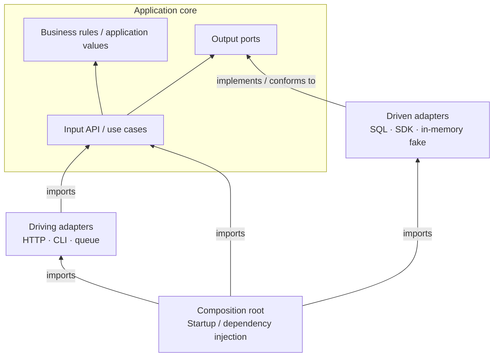
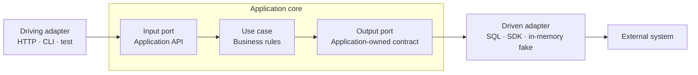

[<kbd>한국어</kbd>](README.ko.md)

# Hexagonal Architecture Skills

**A Hexagonal Architecture (Ports and Adapters) skill for Claude Code and OpenAI Codex.**

Review code, design features, and refactor incrementally to separate business rules from external technologies. Both tools use **the same `SKILL.md`**, with native plugin marketplaces and symlink installation available.

Inspired by the review workflow and shared Claude Code / Codex packaging in [nathankim0/clean-architecture-skills](https://github.com/nathankim0/clean-architecture-skills). The architecture principles follow [Alistair Cockburn's Hexagonal Architecture](https://alistair.cockburn.us/hexagonal-architecture).

## What does it review?

| Area | Review question |
| --- | --- |
| Core independence | Are business rules coupled to HTTP, ORM, database, or vendor SDK implementations? |
| Input ports | Is the application API offered to callers clear? |
| Output ports | Are external capabilities described in the application's vocabulary? |
| Adapter boundaries | Are input, data, and error translation separated from business decisions? |
| Dependency direction | Does the core depend on contracts without importing concrete adapters? |
| Wiring and behavior | Are dependency injection, transactions, validation, and error handling preserved? |
| Testability | Can use cases run without a server or database, and can adapter contracts be verified? |

The skill traces actual calls and dependencies instead of judging architecture by folder names or layer counts. It recommends the smallest change that solves the problem, without prescribing DDD, CQRS, event buses, or an interface for every class.

## Installation

Choose either plugin installation or symlink installation. Installing both may expose duplicate skills.

### Claude Code

Run inside Claude Code:

```text
/plugin marketplace add nathankim0/hexagonal-architecture-skills
/plugin install hexagonal-architecture@hexagonal-architecture-skills
```

Start a new session, then invoke the skill:

```text
/hexagonal-architecture:hexagonal-architecture Review this feature's ports and adapter boundaries.
```

### OpenAI Codex

For CLI versions that support `codex plugin`, run in your terminal:

```bash
codex plugin marketplace add nathankim0/hexagonal-architecture-skills
codex plugin add hexagonal-architecture@hexagonal-architecture-skills
```

Start a new Codex session, then select the skill with `/skills` or invoke it explicitly:

```text
$hexagonal-architecture:hexagonal-architecture Review this feature's ports and adapter boundaries.
```

For versions without `codex plugin`, or IDE environments, use symlink installation below.

### Symlink installation — maintain one shared source

On macOS/Linux, clone this repository and link both tools to the same skill folder:

```bash
git clone https://github.com/nathankim0/hexagonal-architecture-skills.git
cd hexagonal-architecture-skills
skill_source="$PWD/plugins/hexagonal-architecture/skills/hexagonal-architecture"
```

Install as a Claude Code user skill:

```bash
mkdir -p ~/.claude/skills
test ! -e ~/.claude/skills/hexagonal-architecture && test ! -L ~/.claude/skills/hexagonal-architecture && ln -s "$skill_source" ~/.claude/skills/hexagonal-architecture
```

Install as a Codex user skill:

```bash
mkdir -p ~/.agents/skills
test ! -e ~/.agents/skills/hexagonal-architecture && test ! -L ~/.agents/skills/hexagonal-architecture && ln -s "$skill_source" ~/.agents/skills/hexagonal-architecture
```

Run both installation commands in the same shell where you set `skill_source`. The instructions, references, and UI metadata share one source. After `git pull`, both tools can read the updated files. Start a new session if the skill or its changes do not appear. Marketplace installations use tool-managed caches and require the corresponding plugin update.

If a skill with this name is already installed, inspect its folder first. These commands stop when an existing folder or link is present; inspect and clear the destination before retrying. Moving or deleting the source repository breaks the links, so recreate them afterward. For project-only installation, link into the project's `.claude/skills/` or `.agents/skills/` instead of the user directory. If symlinks are unavailable, copy the same skill folder into the appropriate directory.

For manual installations, use these names:

```text
Claude Code: /hexagonal-architecture
Codex:      $hexagonal-architecture
```

Installation paths and plugin packaging follow [Claude Code Skills](https://code.claude.com/docs/en/skills), [Claude Code Plugin Marketplaces](https://code.claude.com/docs/en/plugin-marketplaces), [OpenAI Build Skills](https://learn.chatgpt.com/docs/build-skills), and [OpenAI Plugin Packaging](https://developers.openai.com/plugins/build/plugins).

## Usage examples

The skill can also be selected automatically for relevant requests. Its instructions are written in English, and it responds in the user's language.

**Code review**

```text
Review the order creation flow using Hexagonal Architecture.
Cite actual files and call paths, identify violations, and recommend the smallest fixes.
```

**Feature design**

```text
Design the input ports, output ports, adapters, and wiring for notification delivery
using this project's existing structure. Add only the boundaries it needs.
```

**Incremental refactoring**

```text
Separate this use case's direct payment SDK dependency behind an output port.
Preserve existing error handling and retry behavior, and verify the relevant tests.
```

Review requests produce findings without editing code. Implementation and refactoring requests include the affected callers, wiring, and verification.

## Dependencies and call flow

### Source code dependencies

The arrows below show **the direction of source code references**. Driving adapters call the core's API; driven adapters implement core-owned ports. The composition root references both the core and adapters to assemble them.



The core does not import concrete adapters or startup wiring. Depending on the language, a driven adapter can satisfy its port through an interface, structural typing, a protocol, or another native mechanism.

### Runtime call flow



These arrows show **runtime calls**. A use case can call a driven adapter through an injected port without importing the adapter's implementation. Startup code assembles and injects those implementations. The hexagon represents an inside/outside boundary, not a requirement for six ports.

The [runnable Python example](plugins/hexagonal-architecture/skills/hexagonal-architecture/references/example.md) demonstrates ports, adapters, wiring, and use-case / CLI tests using only the standard library. Apply the pattern using your project's language and conventions.

## Repository structure

```text
hexagonal-architecture-skills/
├── .agents/plugins/marketplace.json       # Codex marketplace
├── .claude-plugin/marketplace.json        # Claude Code marketplace
├── plugins/hexagonal-architecture/
│   ├── .claude-plugin/plugin.json
│   ├── .codex-plugin/plugin.json          # Symlink → ../.claude-plugin/plugin.json
│   └── skills/hexagonal-architecture/
│       ├── SKILL.md                       # Shared instructions
│       ├── agents/openai.yaml             # Codex UI metadata
│       └── references/example.md          # Runnable Python example
├── assets/hero.png
├── README.md
├── README.ko.md
└── LICENSE
```

The skill lives in one folder. The shared plugin manifest is also connected by a symlink. The marketplace catalogs are maintained separately because Claude Code and Codex use different JSON formats. Use `git clone` to preserve the repository's symlinks.

## Attribution and license

- **Inspired by:** [nathankim0/clean-architecture-skills](https://github.com/nathankim0/clean-architecture-skills) — architecture review workflow and shared skill packaging for both tools.
- **Original pattern:** [Hexagonal Architecture — Alistair Cockburn](https://alistair.cockburn.us/hexagonal-architecture).
- **Hero image:** AI-generated for this repository.
- **License:** [MIT](LICENSE). Linked external materials remain the property of their respective authors.
